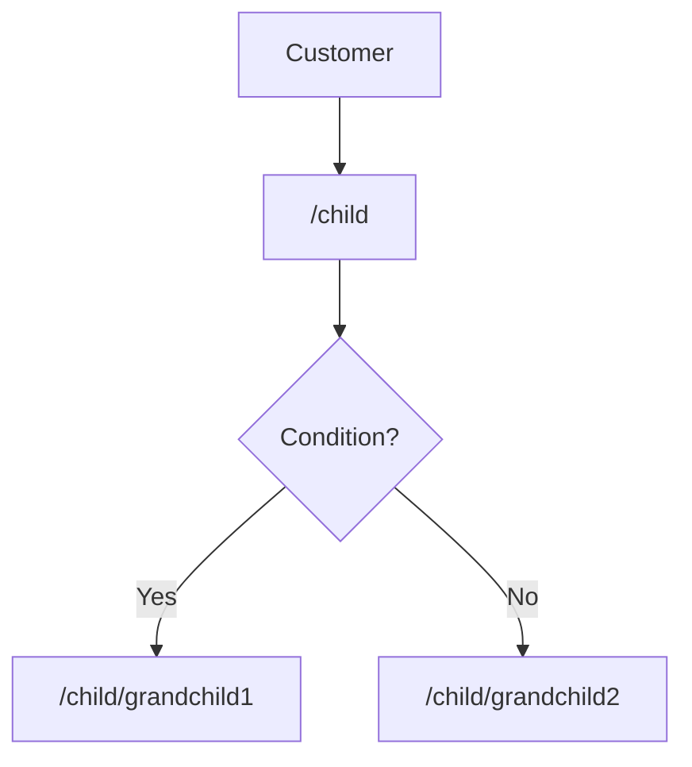

Given cases like below, where will you add the redirect logic?



There are many ways to do that. I prefer adding a dedicated route inside `child` route using `redirectTo` function from Angular@18.

```ts
export const routes: Routes = [
  {
    path: "child",
    component: ChildComponent,
    children: [
      {
        path: "",
        pathMatch: "full",
        redirectTo: () => {
          const shouldRedirectToChild1 = Math.random() > 0.5;
          if (shouldRedirectToChild1) {
            return "grandchild1";
          }
          return "grandchild2";
        },
      },
      {
        path: "grandchild1",
        loadComponent: () => GrandChild1Component,
      },
      {
        path: "grandchild2",
        loadComponent: () => GrandChild2Component,
      },
    ],
  },
];
```

Before Angular@18 I put the logic inside `canActivate`, which is like

```ts
export const routes: Routes = [
  {
    path: "child",
    component: ChildComponent,
    children: [
      {
        path: "",
        pathMatch: "full",
        component: ChildComponent,
        canActivate: [
          () => {
            const router = inject(Router);
            const shouldRedirectToChild1 = Math.random() > 0.5;
            if (shouldRedirectToChild1) {
              return router.parseUrl("/child/grandchild1");
            }
            return router.parseUrl("/child/grandchild2");
          },
        ],
      },
      {
        path: "grandchild1",
        loadComponent: () => GrandChild1Component,
      },
      {
        path: "grandchild2",
        loadComponent: () => GrandChild2Component,
      },
    ],
  },
];
```

From my point of view, it's less good because

- `canActivate` is not as intuitive as `redirectTo`
- `canActivate` requires `component` field to work in this case, while `component` is not actually needed.

Also, there is another solution like

```ts
export const routes: Routes = [
  {
    path: "child",
    component: ChildComponent,
    canActivate: [
      (route: ActivatedRouteSnapshot, state: RouterStateSnapshot) => {
        const isChildRoute = state.url === "/child";
        if (isChildRoute) {
          const shouldRedirectToChild1 = Math.random() > 0.5;
          if (shouldRedirectToChild1) {
            return "grandchild1";
          }
          return "grandchild2";
        }
        return true;
      },
    ],
    children: [
      {
        path: "grandchild1",
        loadComponent: () => GrandChild1Component,
      },
      {
        path: "grandchild2",
        loadComponent: () => GrandChild2Component,
      },
    ],
  },
];
```

The problem with this way is obvious.

- We need to detect whether users are visiting the parent route directly, like `isChildRoute = state.url === "/child"`.
- It's easy to put other non-redirect code inside the above `canActivate` function which violets the single responsibility principle. For example, permission related code. 
- Also, the above `canActivate` will not be triggered if the route is changing from `/child/grandchild2` to `/child` because the `/child` route has been activated.

So, what do you think?

[**Issue**](https://github.com/xianshenglu/blog/issues/)

[**Source**](https://github.com/xianshenglu/blog/blob/master/source/_posts/.md)

## Reference
