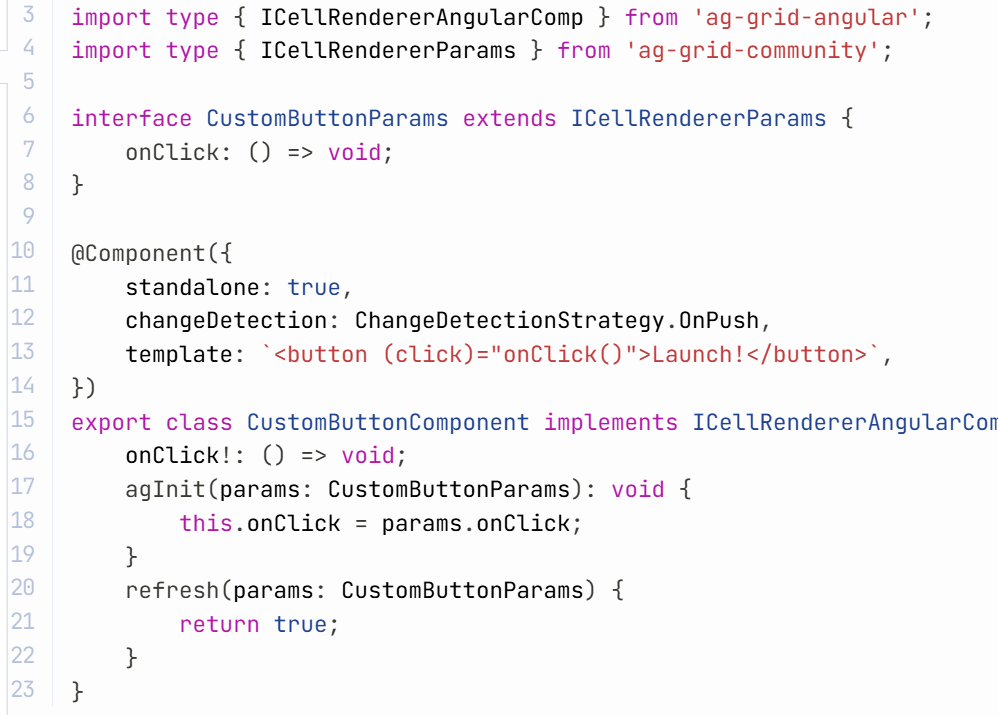
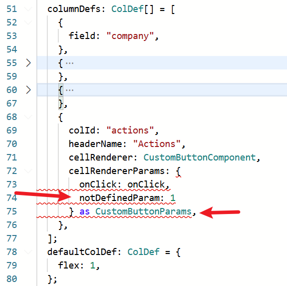

`ag-grid-angular` is a powerful library to display data tables in Angular.

This is the code from `ag-grid-angular` [homepage](https://www.ag-grid.com/angular-data-grid/component-cell-renderer/#custom-props) regarding custom props.



But I don't use it like that. I will show you how I use it when creating custom cell components.

### Create A Base Class

First, I will create an abstract class in another file. For example

```ts
@Component({
  template: ``,
})
export abstract class CellRendererBaseComponent<
  TParams extends ICellRendererParams = ICellRendererParams
> implements ICellRendererAngularComp
{
  protected params!: TParams;
  agInit(params: TParams): void {
    this.params = params;
  }
  refresh(params: TParams) {
    return false; // can be true by default if you want
  }
}
```

Then the actual code will be

```ts
import { ChangeDetectionStrategy, Component } from "@angular/core";

import type { ICellRendererAngularComp } from "ag-grid-angular";
import type { ICellRendererParams } from "ag-grid-community";

interface CustomButtonParams extends ICellRendererParams {
  onClick: () => void;
}

@Component({
  standalone: true,
  changeDetection: ChangeDetectionStrategy.OnPush,
  template: `<button (click)="params.onClick()">Launch!</button>`,
})
export class CustomButtonComponent extends CellRendererBaseComponent<CustomButtonParams> {}
```

If there is another custom component like `CustomButton2Component` you only need to extend `CellRendererBaseComponent` and **optionally** declare the custom params type.

No more duplicated custom params definitions, assignments, similar `agInit` and `refresh` implementations.

### Export The Custom Params Type

By the way, I would also export the custom params type(`CustomButtonParams` in the above example) and use it in the column definition side like this.



So you will see the type error if the type is not aligned.

[**Issue**](https://github.com/xianshenglu/blog/issues/)

[**Source**](https://github.com/xianshenglu/blog/blob/master/source/_posts/.md)

## Reference
